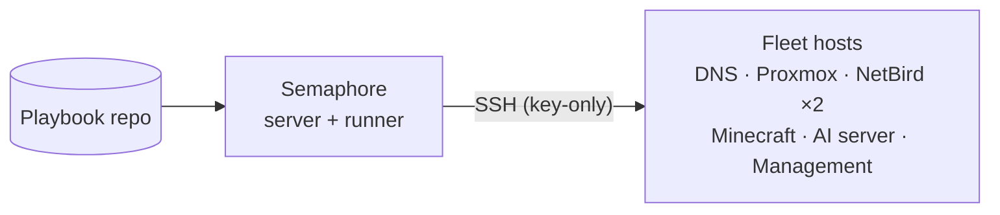

# Ansible

The fleet-automation layer for the homelab. Ansible playbooks are stored in a local git repo and run through **Semaphore**, a self-hosted automation platform that gives the playbooks a web UI, a REST API, and scheduled/on-demand execution. A single mass-update playbook keeps all seven fleet hosts patched, and the fleet is wired for SSH with keys-only auth and tiered sudo.

## Overview

- **Ansible** — the configuration-management engine; playbooks run against the whole fleet.
- **Semaphore** — the self-hosted platform that runs the playbooks on demand, on a schedule, or from a webhook, with a web UI and REST API.
- **The fleet** — seven hosts (the DNS box, the virtualization host, the two VPN endpoints, the game server, the AI server, and the management LXC), all reachable over SSH.
- **Mass-update playbook** — one playbook that patches every host, with per-service handling where apt isn't enough.

## Architecture

### Components

- **Semaphore server** — hosts the web UI, REST API, and task queue; stores projects, templates, inventories, keys, and logs in a database.
- **Runner** — the process that actually executes tasks: it polls the server, clones the playbook repo, and runs the playbook.
- **Ansible** — the engine the runner drives; the full `ansible` package (not just `ansible-core`) so the `apt` module is available.
- **Playbook repo** — a local git repo holding the playbooks; the runner clones it at task time.

## The Ansible fleet

- **Dedicated Ansible key.** A key separate from the agent's own key, stored **encrypted in the Semaphore database** and decrypted on the fly — never written to disk in plaintext.
- **Inventory by role, not label.** The inventory names hosts by their role (the DNS box, the Proxmox host, the two NetBird endpoints, the Minecraft server, the AI server, the management LXC) rather than generic `nodeN` labels, so the inventory reads like the lab.
- **Mass-update playbook.** One playbook runs `apt update` + `dist-upgrade` across the fleet, non-interactively. Where a service isn't apt-managed (the DNS box, the automation layer), the playbook handles that update explicitly. Hosts that don't need anything extra (the game server, the model server) are left alone.
- **All hosts patched, verified.** Every fleet host carries the Ansible key and passwordless sudo for the automation account; the first mass run brought the fleet from dozens of upgradable packages down to a small, expected residual.

## Fleet SSH access model

The fleet is wired for SSH with a deliberate, least-privilege model:

- **Keys-only auth** for the automation accounts — no passwords.
- **Separate non-sudo accounts per agent** — each agent has its own account and only its own public key; the human account is untouched (no-lockout guarantee).
- **The private key lives on the machine that initiates the connection** — not on the targets.
- **Safety tiers enforced in the OS, not by trusting the model** — Tier 0 (non-sudo, default), Tier 1 (a scoped sudoers allowlist), Tier 2 (user-granted). The OS enforces the tier; the agent can't talk its way past it.
- **Outbound-only where it makes sense** — the desktop is outbound-only (no one SSHes into it), and the router is root-SSH-only with no automation account.

## Design decisions

- **Semaphore over raw cron/CI.** A purpose-built automation platform gives the playbooks a web UI, an API, schedules, and per-project isolation — better than ad-hoc cron jobs or a generic CI system for infrastructure automation.
- **Native install, no Docker.** Semaphore runs as a native package (systemd service) on the management LXC, matching the lab's LXC convention rather than adding a Docker dependency.
- **Encrypted key in the DB, not on disk.** The Ansible key is stored encrypted in Semaphore's database and decrypted only when a task runs — so the key isn't sitting in plaintext on the filesystem.
- **One mass-update playbook.** A single playbook that patches the whole fleet (with per-service exceptions) is easier to reason about and audit than per-host scripts.

## Operational lessons

The hard-won bits from standing it up and running it:

- **The SQLite DB path is the `host` field, not the `name` field.** Setting the wrong field created a stray database file named after a default host value. Verify the actual DB location after a migrate.
- **The API surface isn't what you'd guess.** The login endpoint, its request field, and the auth header all differ from the obvious/expected shape — verify against the running version before scripting against the API.
- **Inventory is read from the DB on every run.** Updating the inventory doesn't require a service restart — the runner re-reads it each task.
- **Playbook paths are relative to the repo root.** An absolute path in the template won't resolve; use the path relative to where the runner clones the repo.
- **"777" perms on `authorized_keys` can be a symlink artifact, not a bug.** A symlink is always mode 777 on Linux; the file was a symlink to the host's central key store (the real file is 600), so the alarming perms were a false alarm.
- **A small residual after a mass upgrade is normal.** Ubuntu's phased-update rollout means a full upgrade won't always reach 100% on the first pass; the leftover packages clear on the next cycle.

## Tech stack

- **Ansible** — configuration management (full package, for the `apt` module).
- **Semaphore** — the self-hosted automation platform (Go server + React UI), community edition.
- **SQLite** — Semaphore's database (native install, systemd service).
- **SSH** — keys-only fleet access with tiered sudo.
- **Git** — the playbook repo.

## Related

- [Proxmox](../proxmox/README.md) — the virtualization host that runs the management LXC.
- [n8n](../n8n/README.md) — the other automation layer (event-driven workflows) on the management plane.
- [Wazuh SIEM](../wazuh/README.md) — the security monitoring that automation keeps healthy.
- [Pi-hole](../pihole/README.md) — the DNS box the mass-update playbook patches.
- [← Back to the project index](../../README.md)
