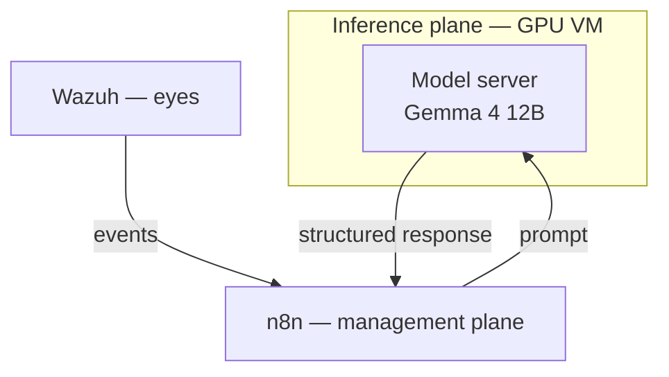

# Local LLM Inference

The inference plane of the homelab — a self-hosted model server on a dedicated GPU VM. It runs a local LLM that the automation layer (n8n) invokes to process SIEM data, log analysis, and summarization, so the agent doesn't have to read raw logs into its own context.

## Overview

- **The network model server** — a local LLM served over HTTP on the inference plane (a dedicated GPU VM).
- **Gemma 4 12B** — the model; a thinking model with a 256K native context window.
- **llama.cpp (Bee fork)** — the runtime, built with CUDA and a quantized KV cache.
- **Invoked by n8n** — the model is a backend the automation layer calls, not a direct chat interface.

## Architecture

The model server sits on the inference plane, isolated from the management plane. n8n sends it a prompt (e.g. a batch of SIEM events to triage) and receives a structured response. The agent never reads the raw logs itself — the model does the heavy lifting and returns a compact verdict.

## The model

- **Gemma 4 12B** — chosen over the previous 8B model on quality.
- **256K native context** — the deciding factor; the previous model had a ~40K hard cap.
- **A thinking model** — reasoning goes in a separate `reasoning` field, the final answer in `content`.

## Runtime & build

- **llama.cpp (Bee fork)** — chosen specifically for its **KVarN quantized KV-cache types**, which let a large context fit a 12 GB GPU.
- **CUDA** build for the GPU, with FlashAttention.
- **Key configuration:**
  - 64K context window
  - KVarN quantized KV cache (key + value)
  - batch 512 / ubatch 128
  - Jinja chat template
  - low reasoning effort, low temperature
- **Run as a service** — a systemd unit, enabled at boot.

## Performance (measured)

- **~30 tokens/s decode** at large context.
- **~700 tokens/s prefill.**
- **~7.9 GB VRAM** at 64K context — fits the 12 GB GPU with headroom.

## Design decisions

- **256K context is the deciding factor.** The model was chosen for its native context window, which is what lets it process large batches of SIEM events in a single pass.
- **Quantized KV cache to fit the GPU.** KVarN quantization of the key/value cache is what makes a 64K context fit a 12 GB card — without it, the context would not fit.
- **The model is a backend, not an interface.** It's invoked by n8n (the automation layer), not chatted with directly — the agent gets a compact structured verdict instead of reading raw logs.
- **Isolated on its own plane.** The model runs on a dedicated GPU VM (the inference plane), separate from the management plane, so inference load doesn't contend with the automation/monitoring workloads.

## Operational lessons

The hard-won bits from running a thinking model as a backend:

- **Thinking models need a generous `max_tokens`.** With reasoning enabled, the model spends ~100+ tokens on reasoning before any content; if the token budget is too small, responses come back empty with a `length` finish reason. Size the budget for the thinking, not just the answer.
- **The model can split its output across reasoning and content blocks.** The final structured output can be split mid-object across the two blocks; the consumer has to concatenate and reassemble it.
- **Quantized KV cache is the lever for context size.** The KV cache (not the weights) is what dominates VRAM at large context; quantizing it (KVarN) is what makes a big context fit a modest GPU.
- **Verify the server's API surface before wiring it up.** The server supports both the chat-completions and responses endpoints, so the automation layer can use whichever it needs without a shim.

## Tech stack

- **Gemma 4 12B** — the model (GGUF).
- **llama.cpp (Bee fork)** — the inference runtime (CUDA, KVarN KV cache).
- **GPU** — a dedicated 12 GB card on the inference plane.
- **systemd** — the service that runs the server.

## Related

- [n8n](../n8n/README.md) — the automation layer that invokes this model.
- [Wazuh SIEM](../wazuh/README.md) — the SIEM whose data this model processes.
- [Proxmox](../proxmox/README.md) — the inference plane that hosts the model.
- [← Back to the project index](../../README.md)
