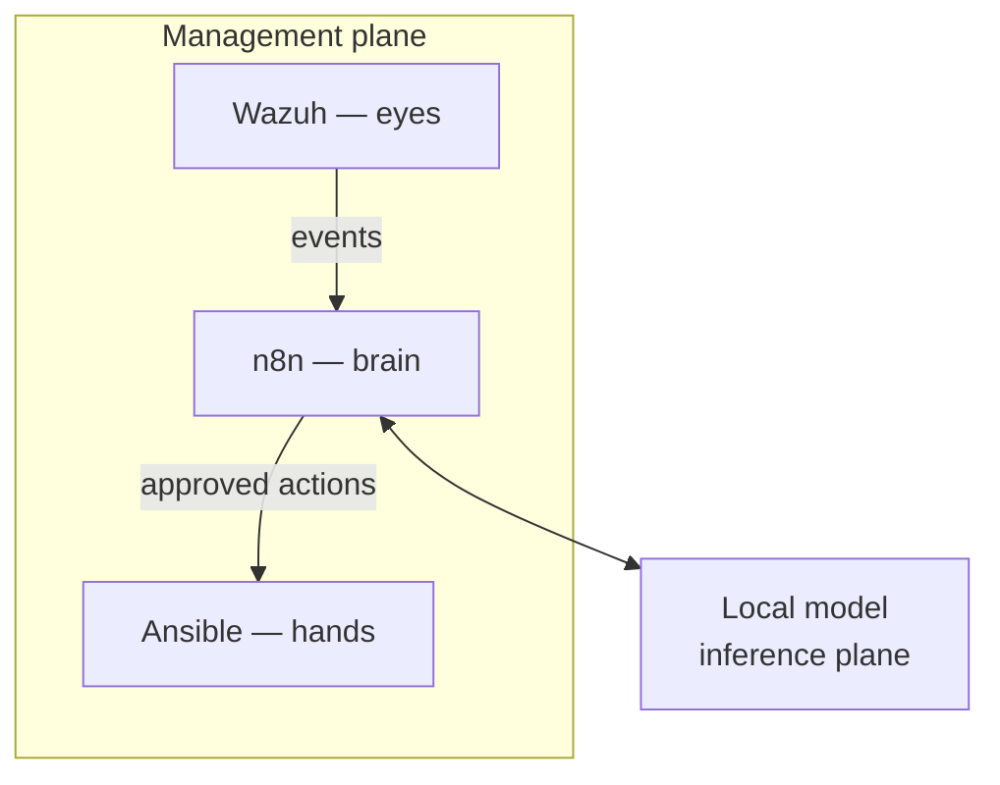

# n8n

The automation layer — "the brain" — of the homelab's management plane. n8n runs deterministic workflows that operate the lab's tools, and invokes the local LLM only when a judgment call is needed (e.g. triaging SIEM events). It's the connective tissue between the SIEM (eyes), the model (inference), and Ansible (hands).

## Overview

- **n8n** — the workflow-automation platform (self-hosted, community edition); workflows are composed from nodes on a canvas.
- **The brain** — the deterministic layer that runs the tools and workflows; the model is called only for anomalies.
- **Co-located with the SIEM** — on the management LXC, next to Wazuh.
- **Model as constrained router** — the local LLM reads n8n output and returns a structured verdict (JSON), not free-form actions.

## Architecture

### The design (eyes / brain / hands)

- **Wazuh = eyes** — detects and logs security events.
- **n8n = brain** — the deterministic layer that runs the tools and workflows, and decides (with the model's help) what to do.
- **Ansible = hands** — executes the fleet actions, but only the ones that pass the approval gate.
- **The model is a constrained router, not an actor.** Workflows run deterministically (no model in the loop for routine work). The model is invoked only for anomalies — it reads the n8n output and returns a structured JSON verdict. Mutating actions (e.g. fleet updates) sit behind a human-approval gate; the model autonomously triggers only read-only/monitoring actions.

## The SIEM digest workflow

The flagship workflow, running on a schedule:

1. **Schedule trigger** — fires at the top of each hour.
2. **Fetch events** — an HTTP request pulls the past hour's events from the Wazuh indexer.
3. **Format** — a code node shapes the events into a readable alert text, filtered to the last hour.
4. **LLM triage** — the local model classifies each event, returning **only JSON**: a `needs_attention` flag plus a one-to-two sentence detail.
5. **Parse** — a code node parses the JSON (stitching together blocks the model split across its reasoning and output).
6. **Write** — only `needs_attention: true` events are appended to a daily digest file; quiet hours leave the file empty.

The result is a daily, human-readable digest of only the events that actually matter — routine noise is filtered by the model, and nothing is written on quiet hours.

## Components

- **Workflows** — collections of nodes that automate a process; they run on a trigger, manually, or when called by another workflow.
- **Triggers** — schedule, webhook, or app-event nodes that start a workflow.
- **The AI Agent node** — adds an LLM-backed agent inside a workflow (chat model + memory + tools).
- **Code nodes** — inline JavaScript for data shaping and parsing.
- **Data tables** — lightweight structured storage inside n8n (no external DB).
- **SQLite** — n8n's database (workflows, credentials, executions).

## Design decisions

- **Deterministic by default, model only for anomalies.** Routine automation runs without the model (fast, reliable, cheap); the model is called only when a judgment call is needed. This keeps the model out of the hot path.
- **The model returns structured JSON, not actions.** The LLM's output is a constrained contract (a flag + a short detail), not free-form text or direct tool calls — so the model can't do anything the workflow doesn't expect.
- **Mutating actions behind an approval gate.** Anything that changes the fleet (e.g. an Ansible update) requires human approval; the model autonomously triggers only read-only/monitoring actions.
- **LXC, not Docker.** n8n runs as a native install on the management LXC, matching the lab's convention.

## Operational lessons

The hard-won bits from building and debugging the workflows:

- **A webhook 404 is usually `public: false`, not a startup-order problem.** The chat/webhook trigger 404s by default until `public` is enabled — the first hypothesis (process start order) was wrong.
- **"The chat node never runs" was three compounding config issues.** An inactive workflow, the wrong response mode, and a mis-set memory session type — all three had to be fixed together.
- **Trace the actual data shape between nodes before blaming the network.** A node referenced a field that didn't exist because the upstream node emitted a different shape than assumed — it was a data-flow issue, not connectivity.
- **The active workflow version lives in `workflow_history`, not the entity's nodes.** Updating the wrong table made "fixes not stick" — the runtime reads the active version from the history table.
- **The model can split its JSON across reasoning and output blocks.** With reasoning enabled, the final JSON was split mid-object across two blocks; the parse node had to concatenate all text blocks and brace-count to recover it.
- **An un-pinned `npm install -g n8n@latest` in a fleet playbook is a footgun.** It pulled a release that required a newer Node.js than the host had, taking n8n down — pin automation installs to a known-good version.
- **The API and CLI were both unreliable on this deployment.** Direct database manipulation ended up being the working way to update workflows; the scoped service log surfaced activation errors the event log didn't.

## Tech stack

- **n8n** — the workflow-automation platform (self-hosted, community edition).
- **The local LLM** — invoked for triage (see [Inference](../inference/README.md)).
- **Wazuh** — the SIEM whose events drive the workflows.
- **SQLite** — n8n's database.
- **JavaScript** — inline code nodes for shaping and parsing.

## Related

- [Wazuh SIEM](../wazuh/README.md) — the eyes that feed the digest workflow.
- [Ansible](../ansible/README.md) — the hands that execute approved fleet actions.
- [Inference](../inference/README.md) — the local model n8n invokes for triage.
- [Proxmox](../proxmox/README.md) — the management plane that hosts n8n.
- [← Back to the project index](../../README.md)
