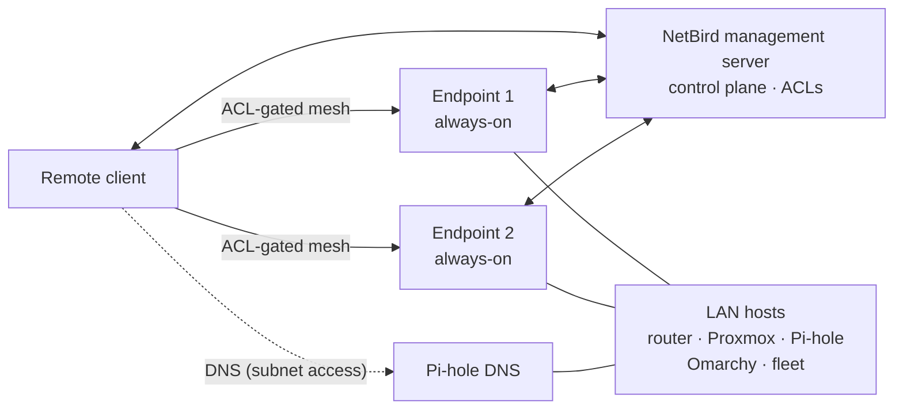

# NetBird

The homelab's remote-access layer — a pair of always-on NetBird endpoints that let me reach the homelab network from outside, over the internet, without opening any holes in the network firewall. NetBird is a mesh VPN: connections are outbound-initiated and peer-to-peer, so it traverses NAT and needs no inbound port-forwarding on the router.

## Overview

- **Mesh VPN** — NetBird builds a peer-to-peer mesh over WireGuard; every connection is outbound-initiated, so it traverses NAT with no port-forwarding on the router.
- **HA pair** — two always-on endpoints on the LAN, so remote access survives the loss of either one.
- **Always-on** — the endpoints run continuously, so the lab is reachable from anywhere at any time.
- **Access control** — per-device access control policies scope what each connected device can reach (e.g. my phone gets access to the LAN subnet; other devices get limited access).
- **Pi-hole DNS** — DNS access is coupled to the access tier: devices granted access to the subnet are routed to the Pi-hole DNS server while on the VPN; devices with limited access are not.
- **Fleet-managed** — the endpoints are part of the 7-host fleet: apt-managed (covered by the mass-update playbook), Wazuh-monitored, and Ansible-managed.

## Architecture

### Components

- **NetBird endpoints** — two always-on nodes on the LAN, each running the NetBird agent and registered with the management server. They bridge remote traffic into the lab.
- **NetBird management server** — the control plane that handles device pairing, authentication, mesh orchestration, and access control policies.
- **Access control policies** — per-device rules that scope what each paired device can reach — e.g. the phone is granted access to the LAN subnet, while other devices get limited reach.
- **Pi-hole DNS integration** — DNS is coupled to the access tier: devices with subnet access are pointed at the lab's Pi-hole DNS server; devices with limited access are not.
- **Remote clients** — the devices I use to reach the lab from outside (phone, laptop), each paired into the mesh.

## Design decisions

- **Outbound-initiated mesh, not a port-forward.** Tunnels are established outbound from each peer, so no management port is ever exposed on the WAN and no firewall hole is opened — the same principle as the router's WireGuard management access.
- **Access control policies, not blanket access.** Each device is scoped by policy to only what it needs (the phone gets the LAN subnet; other devices get limited reach), so a compromised or misused device can't reach the whole LAN — least-privilege remote access.
- **DNS coupled to the access tier.** Devices granted subnet access also get the lab's Pi-hole DNS (same resolution + ad-blocking as the LAN); limited-access devices don't. This keeps DNS from leaking to the ISP for the devices that actually need it.
- **HA pair for remote access.** Two endpoints mean the loss of one (reboot, failed update, dead box) doesn't cut off remote access to the lab.
- **Always-on, fleet-managed.** The endpoints are apt-managed and covered by the same mass-update playbook, Wazuh monitoring, and Ansible management as the rest of the fleet — not fire-and-forget boxes.

## Operational lessons

The hard-won bits from running it in production:

- **Remote access is a first-class fleet citizen.** The endpoints carry Wazuh agents and Ansible keys like every other host, so they're monitored and updated by the same automation — an endpoint that goes dark shows up in the SIEM and gets picked up by the update playbook, not discovered by hand.
- **Redundancy is what keeps remote access alive.** With two endpoints, a single failure (reboot, failed upgrade, dead machine) doesn't strand me outside the lab.
- **Keep management off the WAN.** The lab is reached through the mesh, never a forwarded port — so the router never exposes a management service to the internet.

## Tech stack

- **NetBird** — mesh VPN (WireGuard-based, outbound-initiated, NAT-traversing).
- **Debian** — the endpoint OS (apt-managed).
- **Pi-hole** — DNS + ad-blocking for devices with subnet access.
- **Wazuh** — agent on each endpoint (SIEM monitoring).
- **Ansible** — fleet management (via the Semaphore mass-update playbook).

## Related

- [OpenWrt](../openwrt/README.md) — the router the endpoints sit behind; NetBird is the outbound-initiated alternative to port-forwarding management access.
- [Pi-hole](../pihole/README.md) — the DNS/ad-blocking server that subnet-access devices use while on the VPN.
- [Proxmox](../proxmox/README.md) — the virtualization host on the LAN the endpoints bridge into.
- [Wazuh](../wazuh/README.md) — the SIEM that monitors the endpoints.
- [Ansible](../ansible/README.md) — the fleet automation that updates and manages them.
- [← Back to the project index](../../README.md)
