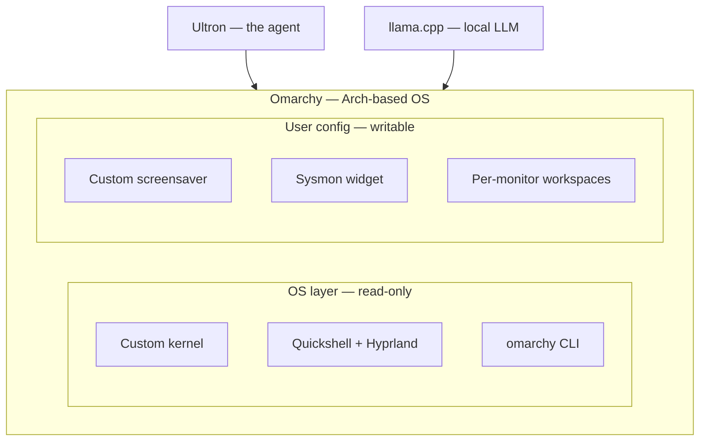

# Omarchy

The operating system the agent runs on — an Arch-based, AI-integrated desktop OS with a custom kernel. It replaced the old Windows + WSL2 + Docker setup, which fought the OS (RAM caps, GPU failures surfacing as Windows bugchecks). On Omarchy, the local LLM and the GPUs run natively, with no container in the way.

## Overview

- **Omarchy** — Arch-based, AI-integrated desktop OS with a custom kernel.
- **Quickshell over Hyprland** — a tiling desktop (a QML shell on a Wayland compositor).
- **The omarchy CLI** — ~450 commands for install, launch, theme, agent, hardware, and more.
- **Clean ownership separation** — the OS layer is read-only; user customization lives in a separate writable config area.

## Why this OS (the migration)

The old stack was Windows → WSL2 → a Docker container. It fought the OS at every layer:

- **WSL exposed only a fraction of the host's RAM** — a hard cap that caused out-of-memory failures for the local LLM.
- **GPU failures surfaced as Windows bugchecks** — the GPU would drop off the bus and the OS blamed Windows.
- **The container carried its own RAM cap** — a second ceiling on top of WSL's.

Migrating to a native OS made all three regimes moot: the LLM runs natively with full host RAM, the GPUs enumerate cleanly under the native driver, and there's no container cap.

## Architecture

The OS layer is read-only territory — applications, config, themes, migrations. All customization goes in the user config area, so OS updates don't clobber user work (and the separation is what makes the customizations below possible).

## The OS

- **Arch-based** with a custom kernel — a fast-moving, minimal base.
- **Quickshell (QML) over Hyprland** — a tiling desktop with a scriptable shell.
- **The omarchy CLI** — ~450 commands; `omarchy agent` launches coding agents, `omarchy agent crash <pid>` diagnoses crashes, `omarchy agent usage` tracks agent spend.
- **Native GPU** — the NVIDIA open kernel modules; both GPUs enumerate cleanly with no container.

## Customizations

The user-config layer carries several custom builds, all living outside the read-only OS layer:

- **Per-monitor workspaces** — each monitor gets its own block of workspaces (Niri-style), so the two displays no longer fight for the same workspace.
- **A custom text screensaver** — a Python engine that draws every frame itself and morphs the OMARCHY wordmark into ULTRON (the stock screensaver can only reveal pre-colored glyphs, not blend two wordmarks).
- **A custom sysmon widget** — a top-bar system-health line (CPU, RAM, both GPUs, disk) with threshold colors, refreshing every 2 seconds, built from a QML module plus a bash collector.
- **Dual-boot with Limine** — Omarchy and Windows share the boot menu; Omarchy is the default.

## GPU stability

A durable service pins the GPU clock and enables persistence mode at every boot, mitigating a recurring "GPU fallen off the bus" failure (a firmware-level silent death on the newer GPU architecture). Zero performance cost.

## Design decisions

- **Native OS over WSL2 + Docker.** The old stack's RAM caps and GPU-failure modes were OS-level problems; a native OS removes them at the root rather than working around them.
- **Read-only OS layer, writable user config.** The clean ownership separation is what lets the customizations survive OS updates — the OS owns its files, the user owns theirs.
- **User installs, not OS packages.** The local LLM runtime is a user install (built from source), not part of the OS layer — so it's independent of OS updates and package management.
- **The agent is a first-class citizen.** The OS ships an `omarchy agent` surface (launch, diagnose, track spend) — the agent is integrated into the OS, not bolted on.

## Operational lessons

The hard-won bits from running and customizing this OS:

- **The old stack's failures were OS-level, not app-level.** WSL's RAM cap, the GPU dropping off the bus as a Windows bugcheck, and the container's RAM cap were all fixed by migrating to a native OS — not by tuning the app.
- **Hyprland scale is quantized, and invalid values are silently rejected.** A scale between the valid steps is dropped with no error logged anywhere; the monitor just holds its last accepted value. Re-read the live scale over the compositor socket to confirm an edit actually took.
- **Quickshell widgets have silent invisibility traps.** A custom bar module can load, parse its data, and run its timer yet render zero-width with no error and no log — e.g. using a width property that resolves to NaN, or assigning a font object where a font-family string is expected.
- **OS updates overwrite custom symlinks.** The screensaver's system symlink gets reset to the stock file on every Omarchy update — re-link it after each update.
- **Don't run the bootloader's auto-update.** It regenerates the boot config from scratch and wipes manual entries (the Windows entry, the timeout) — edit the boot config in place instead.
- **Pin the GPU clock + persistence mode at boot.** That's the durable mitigation for the recurring GPU drop-off — cheaper and more reliable than chasing the firmware.

## Tech stack

- **Arch Linux** — the base (custom kernel).
- **Hyprland** — the Wayland compositor (tiling).
- **Quickshell (QML)** — the scriptable desktop shell.
- **NVIDIA open kernel modules** — native GPU support.
- **Python + QML + bash** — the custom screensaver, widget, and collectors.
- **Limine** — the bootloader (dual-boot).

## Related

- [Ultron](../ultron/README.md) — the agent that runs on this OS.
- [Inference](../inference/README.md) — the local LLM this machine serves.
- [← Back to the project index](../../README.md)
