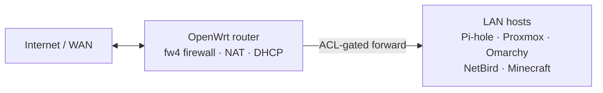

# OpenWrt

The homelab's router — the network edge between the internet and the LAN. It runs OpenWrt, a Linux-based router OS configured entirely through UCI (the Unified Configuration Interface). It provides the firewall, NAT, DHCP, and DNS for the whole lab, and is the boundary that keeps the lab's segments isolated from each other.

## Overview

- **OpenWrt** — Linux-based router OS; all configuration lives in UCI files under `/etc/config`.
- **The network edge** — the WAN/LAN boundary: firewall, NAT (masquerade), DHCP, and DNS for the whole lab.
- **Segment isolation** — WAN-side ACLs refuse forwarding between private (RFC1918) segments, so the lab's segments stay isolated even though they share the LAN.
- **Two interfaces** — SSH (Dropbear) for scripting and the LuCI web UI for interactive config; both are hardening targets.

## Architecture

### Components

- **UCI** — the configuration model: every subsystem (network, firewall, wireless, DHCP, SSH, web) is a config file under `/etc/config`, edited with the `uci` CLI or a text editor.
- **fw4 / nftables** — the firewall (since 19.07): a generator that turns UCI config into an nftables ruleset. Configured with `uci`, inspected with `nft list ruleset`.
- **dnsmasq** — DHCP and DNS.
- **Dropbear** — the SSH server.
- **uhttpd + LuCI** — the embedded web server and its web UI (a front-end over the same UCI store).
- **rpcd** — the RPC daemon that authenticates LuCI.

## The configuration model (UCI)

Everything is UCI. The key gotcha is the **staging model**: `uci set` / `add` / `delete` do **not** write to disk — they stage changes in `/tmp/.uci`. Only `uci commit` writes the staged changes to `/etc/config` (and usually reloads the affected service). `uci changes` shows what's staged but uncommitted. This is the single most common way to "lose" a change on OpenWrt: you set it, it works until the next reboot, then it's gone — because you never committed.

## Firewall (fw4 / nftables)

The firewall is built from **zones** and **rules**:

- **Zones** group interfaces and carry a default policy per direction (`input`, `output`, `forward` = `ACCEPT`/`REJECT`/`DROP`). The stock config: `lan` accepts everything; `wan` rejects input, drops forward, and masquerades (NAT) egress.
- **Rules** add accept/reject/drop entries; direction is implied by `src`/`dest` (both = forward, only `src` = input, only `dest` = output).
- **Redirects** are port forwarding / DNAT — incoming traffic on a source zone rewritten to an internal host.
- **NAT** sections express masquerade or SNAT beyond the zone default.

The lab's key rule set is the **WAN-side ACLs**: they refuse forwarding between private (RFC1918) segments. The router is the boundary that keeps the homelab's segments isolated from each other even though they all sit on the same LAN — a misconfiguration on one segment can't reach another through the router.

## Security hardening

OpenWrt's defaults are already reasonable (no preset root password, no telnet, `wan` rejects input). The hardening locks that down further:

- **SSH (Dropbear)** — key-only auth, bound to the LAN interface only (so a firewall mistake can't expose it), and off the default port.
- **LuCI (uhttpd)** — bound to the LAN address, HTTPS-only with a redirect from plain HTTP, and a **separate password** via `rpcd` (so the web UI and SSH don't share one credential).
- **Stealth WAN** — `wan` input set to `DROP` (silent), WAN ping disabled, unused services dropped.
- **Remote access** — never port-forward SSH or LuCI to the WAN. Internet-facing management is scanned constantly; instead the router is reached over a WireGuard tunnel with a management-only firewall zone.

## Design decisions

- **The router as the isolation boundary.** Rather than trusting the LAN to be flat, the WAN-side ACLs make the router enforce segment-to-segment isolation. One compromised or misconfigured segment can't pivot to the others through the router.
- **Defense in depth on management access.** SSH and LuCI are bound to the LAN interface *and* the firewall rejects WAN input — so a mistake in either layer doesn't expose management to the internet.
- **Remote access over WireGuard, not a port-forward.** An outbound-initiated tunnel with a management-only zone is safer than exposing a management port to the WAN.
- **UCI over hand-edited files.** Scripting config through `uci` (with explicit `commit`) is reproducible and auditable; hand-editing `/etc/config` is reserved for cases where comments must survive (uci rewrites files whole on commit and drops comments).

## Operational lessons

The hard-won bits from running it in production:

- **`uci set` doesn't persist — `uci commit` does.** The staging model means a change that works until the next reboot was never committed. Always `uci commit` (and check `uci changes`) after editing.
- **Static DHCP leases must be `config host` sections, not list entries.** The `dhcp.lan.hosts` list option is not rendered by the dnsmasq init script — only `config host` / `config hostrecord` sections are. A static reservation added as a list entry silently never appeared in the generated dnsmasq config; it had to be re-added as a proper host section.
- **Isolation is enforced at the router, not assumed.** The WAN-side ACLs are what keep the segments apart; without them the shared LAN would let any segment reach any other.
- **Management access is the thing to keep off the WAN.** SSH and the web UI are the highest-value targets for internet scanners; binding them to the LAN and reaching them only over WireGuard removes that exposure entirely.

## Tech stack

- **OpenWrt** — Linux-based router OS; UCI configuration model.
- **fw4 / nftables** — the firewall and NAT engine.
- **dnsmasq** — DHCP + DNS.
- **Dropbear** — SSH; **uhttpd + LuCI** — web UI; **rpcd** — LuCI auth.
- **WireGuard** — the management tunnel for remote access.

## Related

- [Pi-hole](../pihole/README.md) — the DNS box the router hands out as the network DNS.
- [NetBird](../netbird/README.md) — the VPN endpoints behind the router.
- [Proxmox](../proxmox/README.md) — the virtualization host on the LAN.
- [Omarchy](../omarchy/README.md) — the desktop on the LAN.
- [← Back to the project index](../../README.md)
