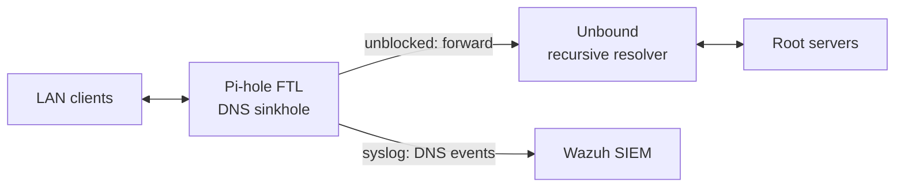

# Pi-hole

Network-wide DNS ad-blocking and a privacy-first recursive resolver for the homelab. Pi-hole is the DNS server for the whole LAN: every client points its DNS at it, and it resolves queries against a compiled blocklist ("gravity") of ad, tracker, and privacy-infringing domains — replying `0.0.0.0` for blocked names and forwarding everything else to a local recursive resolver. It is the network's default DNS and a telemetry source for the SIEM.

## Overview

- **Pi-hole** — self-hosted, network-wide ad-blocker / DNS sinkhole (open-source, GPL-3.0).
- **Default DNS for the network** — the router's DHCP hands out Pi-hole's address as the DNS server, so every client uses it automatically with no per-device config.
- **Unbound** — a local recursive resolver for privacy (no third-party upstream logging) and DNSSEC validation.
- **Telemetry source** — its DNS-query log is forwarded (agentless syslog) to the [Wazuh SIEM](../wazuh/README.md).

## Architecture

### Components

- **pihole-FTL** — the core engine (C++): a fork of `dnsmasq` with Pi-hole's blocking, caching, and query-logging logic. It also embeds the DHCP server, the CivetWeb web server, and the REST API.
- **Gravity** — the compiled blocklist of ad/tracker/privacy domains, updated from one or more blocklist URLs.
- **Unbound** — the local recursive resolver, providing privacy (no third-party upstream logging) and DNSSEC validation.
- **SQLite** — stores the domain lists and query logs.
- **CivetWeb** — the embedded web server for the admin dashboard and API.

## How it works

- **Blocking flow** — a client query arrives at Pi-hole. If the name matches gravity, a regex filter, or a local rule, Pi-hole replies `0.0.0.0` (the default `NULL` blocking mode — no block page). Otherwise the query is forwarded to the local Unbound resolver, which resolves it recursively against the root servers with DNSSEC validation.
- **Caching** — FTL keeps a DNS cache (default 10,000 entries, not persistent across restarts) and tracks the fastest-responding upstream to cut redundant queries.
- **Privacy** — a configurable privacy level controls how much query detail is logged, from full detail down to fully anonymous.

## Design decisions

- **Network-wide sinkhole.** One DNS server for the whole LAN means every device gets ad/tracker blocking with zero per-device configuration — the router's DHCP just hands out Pi-hole's address.
- **Local recursive resolver (Unbound) instead of a public upstream.** Routing recursion through a local Unbound means no third party sees the queries (privacy) and DNSSEC is validated locally. The trade-off is maintaining your own recursive resolver — which is exactly where the trust-anchor bug below bit.
- **Agentless telemetry to the SIEM.** Pi-hole is a lightweight dedicated box, not a general-purpose Linux host; pushing a full agent onto it is overkill. Its native log is already the right telemetry, so it is forwarded to Wazuh via syslog.
- **`NULL` blocking mode.** Returning `0.0.0.0` (rather than a block page or NXDOMAIN) is the recommended default — clients don't even attempt a connection, which reduces traffic and avoids HTTPS timeouts.

## Operational lessons

The hard-won bits from running it in production:

- **"Nothing works" → check layers before blaming anything.** When DNS died, browsers, `curl`, and even `llama-server` (which does a startup network check) all hung. The diagnosis walked the layers — DHCP (lease/route) → L2/L3 (ping) → DNS (direct queries to the local resolver vs public DNS) — and found DHCP was never broken; only the local resolver was dead.
- **A DNS server that answers ping but not DNS queries is a service failure, not a network failure.** The box answered ping and its web UI was up, but not DNS, while public DNS resolved fine. The fix was in the service journal, not the cable.
- **The root cause was a corrupt trust-anchor file.** Unbound's auto trust-anchor file was written with each root KSK twice (once `VALID`, once `MISSING`). Unbound refuses to start when the same trust anchor is presented twice, so it crash-looped. It was an upstream bug, fixed in a later release that was not available on the box's distro.
- **A corrupt file read only at startup is latent until the next restart.** The corruption was written on one start but only caused an outage when the service was restarted — so the symptom appeared hours later, after a reboot.
- **A one-off fix isn't permanent when the corrupting step runs on every start.** The file is rewritten by a service-start step on every boot, so a manual dedupe got overwritten. The permanent fix is a systemd drop-in that restores a clean trust-anchor file *after* the buggy step and *before* the resolver launches — so every start begins from a known-good file.
- **Don't debug the model when the resolver is dead.** `llama-server` hangs at startup when DNS is down (its startup network check) — the model was fine; the DNS was the problem.

## Tech stack

- **Pi-hole** — FTL engine (dnsmasq fork), CivetWeb web server, SQLite, gravity blocklist.
- **Unbound** — local recursive resolver + DNSSEC validation.
- **systemd** — service drop-in for the trust-anchor fix.
- **rsyslog** — syslog forwarding of DNS events to the SIEM.

## Related

- [OpenWrt](../openwrt/README.md) — the router that hands out Pi-hole as the network DNS.
- [Wazuh SIEM](../wazuh/README.md) — receives Pi-hole's DNS telemetry.
- [Proxmox](../proxmox/README.md) — where the DNS box runs.
- [Monitoring](../monitoring/README.md) — DNS health is part of the lab's monitoring.
- [← Back to the project index](../../README.md)
