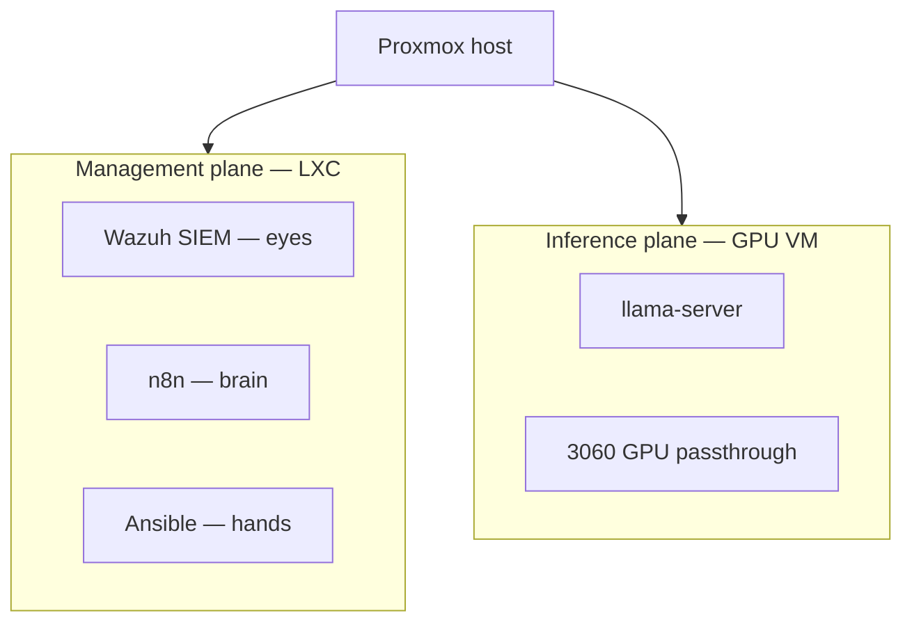

# Proxmox

The virtualization host for the homelab. Proxmox runs the lab's workloads as LXC containers and VMs on a dedicated server, organized into two planes: a **management plane** (the SIEM, automation, and fleet tooling) and an **inference plane** (the local LLM model with GPU passthrough). The server was reset and rebuilt from scratch, with every service installed clean.

## Overview

- **Proxmox VE** — the virtualization platform (LXC containers + KVM VMs) for the lab.
- **Two planes** — management (SIEM + automation + fleet tooling) and inference (local LLM + GPU), kept separate.
- **Dedicated server** — its own host on the lab LAN, separate from the desktop and the router.
- **Clean rebuild** — the server was reset and rebuilt from scratch; every service is a fresh install, no migration of old configs or data.

## Architecture

### The two planes

- **Management plane (LXC container)** — the "eyes, brain, and hands" of the lab: the [Wazuh SIEM](../wazuh/README.md) for security monitoring, [n8n](../n8n/README.md) for automation, and [Ansible](../ansible/README.md) for fleet management (added in a later phase). Runs as a single LXC container.
- **Inference plane (GPU VM)** — a lean VM running the local LLM ([llama-server](../inference/README.md)) with the GPU passed through. Model only, no other services — kept lean so a model update or GPU issue can't affect the management plane.

## Design decisions

- **Two-plane separation.** Management (monitoring + automation) and inference (the model) run on separate workloads, so a model update, GPU fault, or a heavy inference load can't take down the SIEM or the automation. The inference VM is deliberately lean — model only.
- **LXC over Docker.** Most workloads are LXC containers on Proxmox rather than Docker, to keep the desktop (Omarchy) clean and light — the heavy lifting lives on the dedicated server, not the workstation.
- **GPU passthrough for inference.** The inference plane is the first actual VM (not an LXC) because it needs the GPU passed through to the guest — something LXC containers can't do cleanly.
- **Clean rebuild over migration.** After a full reset, every service was reinstalled fresh rather than migrating old configs, data, and indexes. A clean install is easier to reason about and document than a migrated one with unknown state.

## Operational lessons

The hard-won bits from running it in production:

- **Reset and rebuild clean, don't migrate.** When the server was reset, the workloads were rebuilt from scratch with fresh installs rather than migrating old configs and data. A clean rebuild is easier to document and reason about than inheriting unknown state.
- **Separate the planes.** Keeping the SIEM/automation on a management LXC and the model on a lean GPU VM means a model update or GPU fault can't take down monitoring or automation — and vice versa.
- **LXC for most, VM only when you need hardware passthrough.** LXC containers are lighter and faster for general workloads; the GPU VM exists only because the model needs the GPU passed through to the guest.
- **Keep the desktop out of the heavy lifting.** Running the workloads on the dedicated Proxmox server (not Docker on the workstation) keeps the desktop clean and responsive.

## Tech stack

- **Proxmox VE** — LXC containers + KVM VMs.
- **Wazuh** — the SIEM (management plane).
- **n8n** — automation (management plane).
- **Ansible** — fleet management (management plane, later phase).
- **llama.cpp / llama-server** — the local LLM (inference plane).
- **NVIDIA 3060** — GPU passthrough for inference.

## Related

- [Wazuh SIEM](../wazuh/README.md) — the security monitoring on the management plane.
- [n8n](../n8n/README.md) — the automation layer on the management plane.
- [Ansible](../ansible/README.md) — fleet management on the management plane.
- [Inference](../inference/README.md) — the local LLM on the inference plane.
- [OpenWrt](../openwrt/README.md) — the router at the edge of the lab LAN.
- [← Back to the project index](../../README.md)
