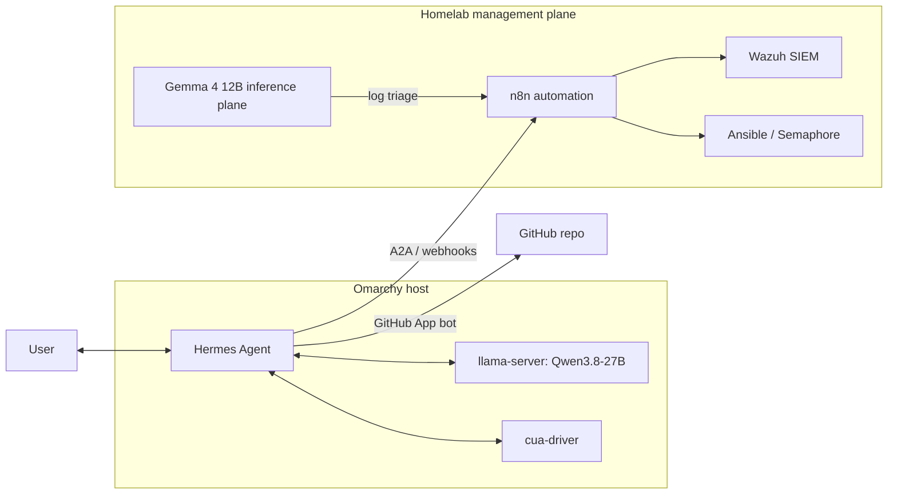

# Ultron

An AI personal assistant and partner that runs the homelab. Built on the **Hermes Agent** harness, running bare-metal on an Arch-based desktop, and driven entirely by a **local large language model** — no cloud dependency. Ultron is the operator that ties the lab's management plane together: it watches the SIEM, drives the automation, and applies fleet changes — while delegating heavy log triage to a separate inference plane to keep its own context lean.

## Overview

- **Hermes Agent** harness, running bare-metal on **Omarchy** (an Arch-based Linux desktop).
- **Local LLM backend** — a 27B multimodal model served natively via `llama-server`; no cloud API.
- **Native vision** — image analysis goes straight to the local model (raw pixels in context), no auxiliary vision model.
- **Interfaces** — Discord (remote access), a GitHub App bot (repo automation), and A2A/webhooks (agent-to-agent).
- **Role in the lab** — the partner in the management plane: Wazuh is the *eyes*, n8n is the *brain* (automation), Ansible is the *hands*; Ultron is the one operating them.

## Architecture

### Components

- **Hermes Agent** — the harness: tool use, sessions, skills, and the connectors below.
- **llama-server** — serves the local model over an OpenAI-compatible API; the agent's "brain."
- **cua-driver** — computer-use / per-window screen capture, so the agent can see and act on the desktop.
- **Connectors** — Discord (remote access), GitHub App bot (repo automation), A2A/webhooks (agent-to-agent).

## The model

- **Qwen3.8-27B GSQ-RCO** — a 27B multimodal (image-text-to-text) model, non-uniformly quantized by ISTA DASLab (Gumbel-Softmax + Riemannian Constrained Optimization). Each weight tensor gets its own quant type, allocated by gradient-based sensitivity search.
- Running the **IQ3_S-mtp** variant (11.8 GB, 3.50 bpw) — the provider's recommended, task-lossless operating point: it matches the BF16 base on the hard benchmarks at ~4.6x smaller.
- Served at **~90K context** with a KVarN4 KV cache, single-GPU CUDA offload, and **MTP-3 speculative decoding** for speed.
- The `-mtp` head adds speculative decoding (quality unchanged, faster decode); the model ships a vision projector for image input.
- **Current resource usage.** ~16 GB VRAM and ~10 GB system RAM in steady operation.

## Vision

- **Native vision routing** — image analysis goes directly to the local 27B model (raw pixels in context, `supports_vision: true`). No separate/auxiliary vision model — the multimodal base handles it, which keeps the stack simple.
- **Per-window screen capture** via a standalone `cua-driver` (overridable via an env var), so the agent can capture and reason about specific windows rather than the whole screen.

## Interfaces

- **Discord** — remote access to the assistant (a managed connector).
- **GitHub App bot** — pushes to the portfolio repo; commits are authored under the human, the bot is push-only.
- **A2A / webhooks** — agent-to-agent calls into the n8n automation layer (replacing an earlier A2A channel).

## Design decisions

- **Local LLM, no cloud.** Privacy and control: the model runs on local hardware, so nothing leaves the lab. The cost is hardware — a 24-core CPU and dual GPUs.
- **Native vision over a separate vision model.** The 27B is multimodal, so routing images to it directly avoids maintaining a second model and a second inference path.
- **Bare-metal, not a container.** The earlier Docker/WSL setup had GPU-freeze and OOM failures; running the inference stack bare-metal on the desktop eliminated both.
- **Partner, not a fixed-scope tool.** Ultron has no hard boundary — it grows with the work. It operates the homelab's management plane rather than owning a single service.
- **Context management.** Heavy log triage is delegated to the inference plane (a 12B model on a dedicated GPU VM) so the assistant's own context stays lean — it reads summaries, not raw logs.

## Operational lessons

The hard-won bits from running it in production:

- **Bare-metal fixed the Docker-era failures.** The old container/WSL setup had two distinct failure regimes — a GPU-freeze regime and a WSL OOM regime. Migrating the inference stack to bare-metal on the desktop under the same engine solved both; neither has recurred since.
- **The 12 GB card is the ceiling for the 27B.** Testing the 27B on a 12 GB card showed MTP-2 hard-OOMs (even with reduced cache); MTP-1 is the max that fits at 64K. That's why the 27B runs on the 16 GB card and the heavier log-triage work is offloaded to a 12B model on the inference plane.
- **Stay on CUDA, not Vulkan.** llama.cpp's Vulkan runtime has been reported to crash silently with GSQ-RCO quants. The stack runs CUDA and shouldn't move to Vulkan without re-testing.
- **The Discord connector's identity is fixed.** The managed Discord connector always operates as its own bot, not the Ultron chat bot — the identity can't be swapped. Debugging the wrong bot's token was a dead end.
- **Discord role permissions read stale.** The Discord roles endpoint returns stale permission integers even after they're set in the UI. Verify by attempting the action, not by reading the integer.
- **Integration-managed roles can't be edited.** Discord blocks editing a role managed by an integration; the fix is to assign a separate, unmanaged role to the bot member.

## Tech stack

- **Hermes Agent** — the agent harness.
- **llama.cpp / llama-server** (CUDA) — local model serving.
- **Qwen3.8-27B GSQ-RCO** (IQ3_S-mtp) — the base model.
- **cua-driver** — computer use / screen capture.
- **Discord** (managed connector) — remote access.
- **GitHub App** — repo automation.
- **A2A / webhooks** — agent-to-agent.

## Related

- [Inference](../inference/README.md) — the dedicated GPU-VM model that does log triage.
- [Omarchy](../omarchy/README.md) — the desktop the assistant runs on.
- [n8n](../n8n/README.md) — the automation layer Ultron drives.
- [Wazuh SIEM](../wazuh/README.md) — the security telemetry Ultron watches.
- [Ansible](../ansible/README.md) — the fleet-management layer.
- [← Back to the project index](../../README.md)
