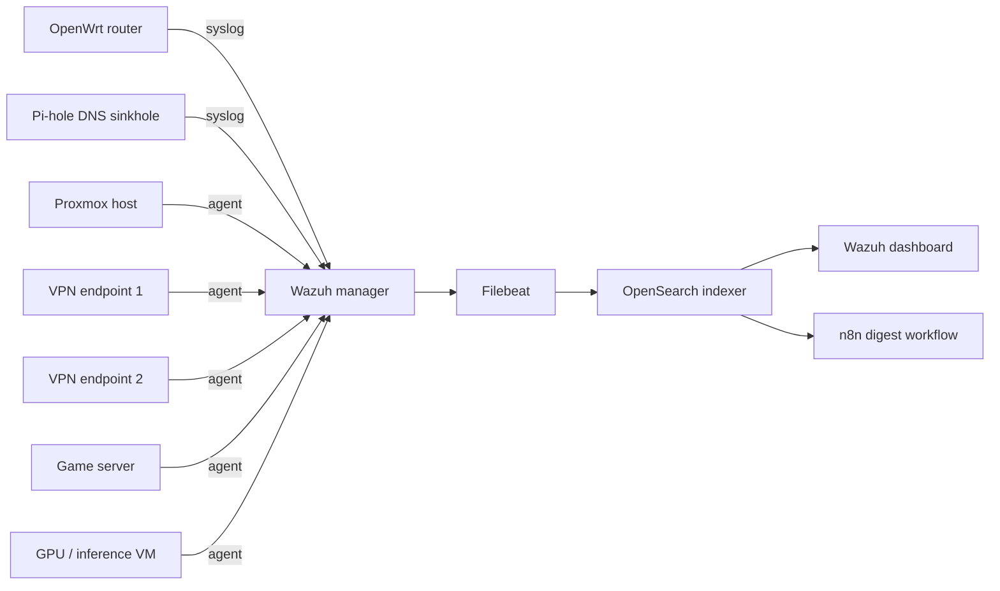

# Wazuh SIEM

Centralized security monitoring for the homelab. Wazuh ingests telemetry from the network edge and every fleet host, correlates it into security events, and surfaces them through a web dashboard and a programmatic API — the "eyes" of the lab's management plane.

## Overview

- **Wazuh 4.9.2**, deployed as an **all-in-one (AIO)**: indexer, manager, dashboard, and Filebeat on a single management container.
- Part of a three-part management plane:
  - **Wazuh** — the *eyes*: detect and correlate security events.
  - **n8n** — the *brain*: triage and alert (an hourly, [LLM-assisted SIEM digest](../n8n/README.md)).
  - **Ansible / Semaphore** — the *hands*: apply fleet-wide changes.
- The AIO sits on the **management container**, co-located with n8n and the Ansible control plane.

## Architecture

### Data sources

- **Agentless syslog** from two edge devices — deliberately no agents on them:
  - **OpenWrt router** — forwards its `logread` stream (SSH, LuCI, DHCP, network changes).
  - **Pi-hole** — rsyslog tails the Pi-hole log and forwards DNS-query events.
- **Wazuh agents** on the five fleet hosts (Proxmox host, two VPN endpoints, game server, GPU/inference VM).

### Components

- **Wazuh manager** — receives syslog + agent traffic; runs analysisd / remoted / authd. Management API on `55000` (HTTPS).
- **OpenSearch indexer** — stores events; listens on `127.0.0.1:9200` only (localhost). This is where event queries actually go — the Wazuh API is management-only and has no event-query endpoint.
- **Wazuh dashboard** — web UI on `443` (HTTPS), authenticated by the indexer's OpenSearch security store.
- **Filebeat** — ships the manager's `archives.json` into the indexer.

## Design decisions

- **AIO on one container.** Indexer, manager, dashboard, and Filebeat share a host. Because the indexer is bound to localhost, co-locating the [n8n digest workflow](../n8n/README.md) on the same container lets it query the indexer locally — no exposed OpenSearch port, no extra network surface.
- **Agentless at the edge.** The router and Pi-hole are lightweight and not general-purpose Linux boxes; pushing a full Wazuh agent onto them is overkill. Syslog is already their native telemetry channel, so forwarding it is zero-friction and keeps those boxes clean.
- **Agents on the fleet.** The five real hosts run full Wazuh agents for file-integrity, process, and vulnerability telemetry that syslog alone can't provide.
- **State-change-only monitoring.** The alerting design reports only transitions (up→down, down→up) and stays silent when healthy — a philosophy carried into the n8n digest workflow.

## Data flow

`remoted → analysisd → archives.json → Filebeat → OpenSearch indexer → dashboard / API`

A break at any link produces the same symptom — packets on the wire, nothing in the index — so debugging means walking the chain link by link.

## Operational lessons

The hard-won bits from running it in production:

- **Indexer startup under contention.** On a small container, all services start in parallel and OpenSearch can take well over the default 180s `TimeoutStartSec`, so systemd kills it and it stays down. Fix: raise `TimeoutStartSec` (to 600s), add `Restart=on-failure`, and order the dependent services after it (Wazuh → n8n → Semaphore) with soft `After=` only, so one failure doesn't block the rest.
- **Two independent login stores.** The dashboard web login is authenticated by the **indexer's** OpenSearch security store (`internal_users.yml`), *not* the Wazuh API's `rbac.db`. A user created only in `rbac.db` will never log into the web UI — a misdiagnosis that cost days. Adding a dashboard user means editing `internal_users.yml` and pushing it with `indexer-security-init.sh`.
- **The indexing pipeline has two independent switches.** Missing events were caused by `logall_json` being `no` (archives written as `.log`, but Filebeat reads `.json`) *and* the Filebeat `archives` module being disabled. Both must be set; they're independent.
- **"Active" doesn't mean healthy.** The `wazuh-manager` service can report *active* while individual daemons (modulesd, execd, syscheckd, logcollector) are dead — the dashboard then shows "daemons not ready." Check `wazuh-control status`, not just `systemctl is-active`; fix with `wazuh-control restart`.
- **Rootcheck false positives on newer distros.** On a recent Ubuntu release, rootcheck's signature DB lacks the exact MD5 hashes for core binaries, so it fires hundreds of "trojaned file" alerts on `cat`, `ls`, `date`, etc. Expected and benign — left as-is rather than chasing it.
- **Vulnerability detection eats disk.** The vuln-detection data can consume ~15 GB; on a constrained container that fills the disk and breaks service restarts (PID-file writes fail). Kept enabled once the container had enough headroom.
- **Password-tool gotcha.** `wazuh-passwords-tool.sh` silently changes *indexer* passwords unless you pass `--api` — and it can't set custom dashboard users at all. For those you drive `securityadmin.sh` directly: back up → patch the hash → push back → sync the local file.

## Tech stack

- **Wazuh 4.9.2** — manager, OpenSearch indexer, dashboard, Filebeat (AIO).
- **OpenSearch Security** — `internal_users.yml`, `securityadmin.sh`, `indexer-security-init.sh`.
- **systemd** — service ordering, `TimeoutStartSec` drop-ins, `Restart=` policies.
- **rsyslog / OpenWrt `logread`** — syslog forwarding from the edge.
- **[n8n](../n8n/README.md)** — the downstream SIEM digest workflow (LLM-assisted triage).

## Related

- [← Back to the project index](../../README.md)
